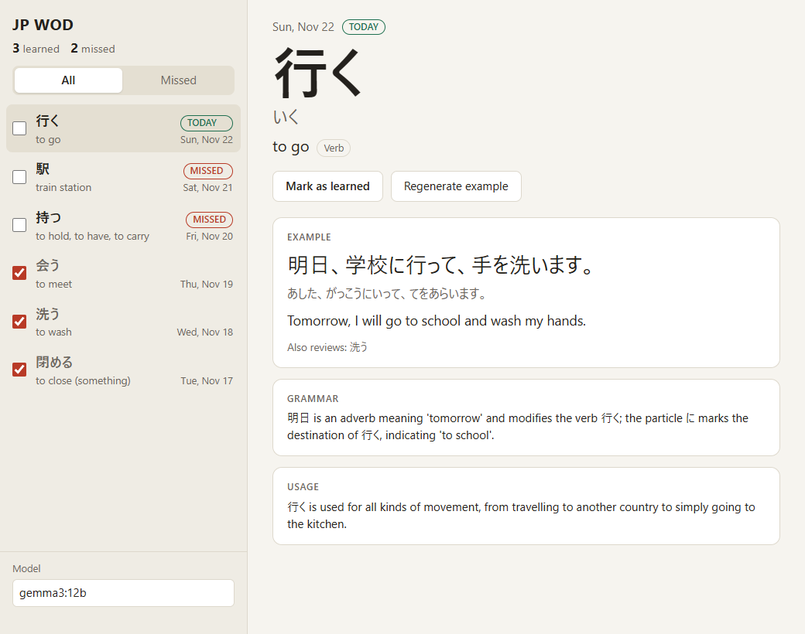

# JP WOD

[](https://github.com/CleNel/jp-wod/actions/workflows/test.yml)

A Windows desktop app that shows one Japanese word a day, with an example sentence, its reading, a translation, and two short study notes written by a language model running on your own computer. Days you skip pile up in a **Missed** backlog you can catch up on at your own pace.



Everything runs locally: no account, no cloud service, no data leaves your machine.

## Requirements

- **Windows 10 or 11.** Other platforms are untested.
- **[Node.js](https://nodejs.org) 22.2 or newer** (developed on Node 24), to run from source.
- **[Ollama](https://ollama.com)** with a model installed. The default is `gemma3:12b` (about 8 GB to download). On an 8 GB graphics card it runs partly on the CPU and takes roughly 10 to 25 seconds per sentence; the smaller `gemma3:4b` is much faster but writes noticeably weaker sentences. You can type any installed model name into the **Model** field in the sidebar.

The app works without Ollama too: you still get the word, its reading, and its meaning. The sentences fill in later, once Ollama is available.

## Quick start

```
git clone https://github.com/CleNel/jp-wod.git
cd jp-wod
npm install
ollama pull gemma3:12b
npm start
```

Make sure Ollama is running (on Windows its tray app starts it). The first `npm start` also downloads Electron (about 100 MB), so it takes a minute before the window opens. If that download is interrupted and `npm start` then complains that Electron failed to install, delete `node_modules/electron` and run `npm install` again. The first sentence after launch can also take a minute while the model loads.

To build a regular installer instead, run `npm run dist` and open `dist/JP WOD Setup 0.1.0.exe`. It installs per user and needs no admin rights. The build is **unsigned**, so Windows SmartScreen may warn the first time you run it.

## How it works

- **One word per day.** Words come from [`data/words.txt`](data/words.txt) (117 beginner words to start with) in a shuffled rotation that is fixed the first time you run the app. A day's word never changes once assigned.
- **The model never picks the word.** It only writes an example sentence, an English translation, and two one-sentence notes (grammar and usage). The hiragana reading is computed by a dictionary, not by the model, because models get readings wrong too often.
- **Missed days.** Every past day you haven't checked off appears in **Missed**. Check a day off, or un-check it, from the list or from the detail view. Skipping days is fine; the PC can be off for a week and nothing is lost.
- **Sentences are written on the day.** Today's first, then missed days, newest first. While one is being written you see the word and a loading indicator. If Ollama is off or the model is missing, a banner says so and the sentences fill in automatically (the app retries on launch, after waking from sleep, and every 10 minutes).
- **Review.** Each sentence is asked to reuse one word you have already checked off, so earlier words come back in new contexts. It is shown as "Also reviews".
- **Always on.** Closing the window hides it to the tray; use the tray menu to open or quit. The installed app can launch at login (hidden in the tray), switched on or off from the tray menu. At midnight, and after waking from sleep, the new day appears by itself.

**The notes can be wrong.** A local model makes grammar mistakes, and about half of the grammar notes in testing had some. Treat them as a study aid and check anything that matters against a dictionary or a teacher. **Regenerate example** writes a new one.

## Adding words

Add lines to [`data/words.txt`](data/words.txt), one per word, in this format:

```
written|reading|meaning|part of speech
```

For example `食べる|たべる|to eat|verb`. Blank lines and lines starting with `#` are ignored. The part of speech is `verb`, `noun`, `i-adjective` or `na-adjective`.

- **Always add new words at the end of the file.** The saved order only grows at the end, so words already assigned to days never move. New words show up after the current rotation has been used. A test fails if the original beginner list is changed.
- **Run `npm test` afterwards.** Some words behave differently from how they look (a verb ending in る can be either of two kinds, 綺麗 looks like an i-adjective but isn't, 行く has an irregular て-form). The tests tell you which new words need an entry in [`data/exceptions.txt`](data/exceptions.txt) and what to check, and they also flag a listed reading that disagrees with the dictionary. Please look these up rather than guessing.

## Where your data is stored

Your progress lives in `%APPDATA%\jp-wod\state.json` (usually `C:\Users\<you>\AppData\Roaming\jp-wod`), never in the install folder, so updating or uninstalling the app keeps it. It holds your start date, the word order, each day's checked-off state and sentence, and the settings.

- **Back up** by copying the file. **Start over** by deleting it while the app is closed.
- **Catch-up test:** with the app closed, move `startDate` earlier to create a missed week.
- **Another Ollama address** (the default is `http://127.0.0.1:11434`): with the app closed, edit `settings.host` in the file. Use the IP address rather than `localhost`, which on Windows can resolve to an address Ollama isn't listening on.

## Development

```
npm test         # unit tests (node --test)
npm start        # run from source
npm run pack     # unpacked app in dist/win-unpacked
npm run dist     # Windows installer in dist/
npm run icons    # regenerate the icons in assets/ and build/
node scripts/try-ollama.js gemma3:12b 10 --one-review   # try a model on real words
```

The tests run on every push and pull request (see `.github/workflows/test.yml`). They need no Ollama and no Electron: the Ollama client is tested against a fake `fetch`, and the interface logic is plain functions.

| Path | What it holds |
| --- | --- |
| `main.js`, `preload.js` | Electron main process, tray, window, and the small API exposed to the page |
| `renderer/` | The interface (plain HTML, CSS and JavaScript, no framework) |
| `lib/` | Dates, word list, store, Ollama client, generation queue, readings, and the logic behind the tray, midnight and wake handling |
| `data/` | The word list and the irregular-word registry |
| `test/` | Unit tests |

Design decisions, with the evidence behind them (which model, why readings are computed, what was tried and dropped), are written down in [`CLAUDE.md`](CLAUDE.md).

## License

[MIT](LICENSE)
